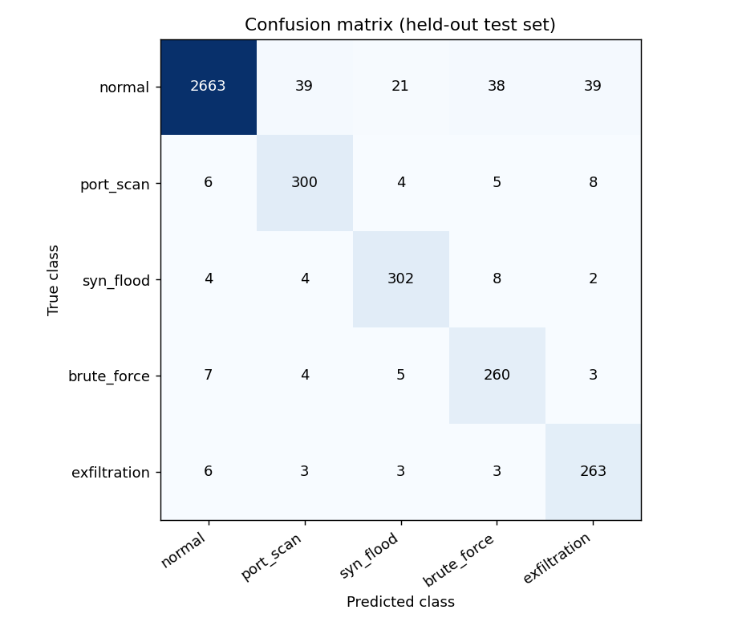
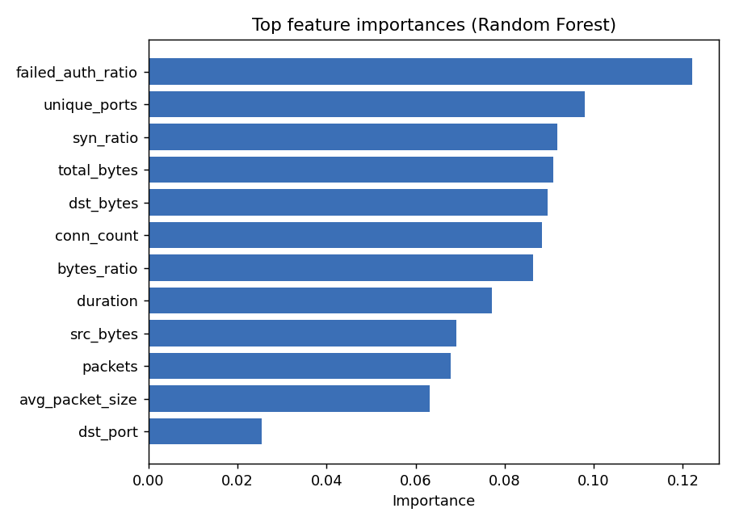

# AI Network Intrusion Detection

A machine-learning project that detects malicious network traffic. It classifies network flows into five classes using a Random Forest, and flags unusual flows with an Isolation Forest anomaly detector.

| Class | Description |
|-------|-------------|
| `normal` | Everyday web, DNS, mail and SSH traffic |
| `port_scan` | One source probing many ports quickly |
| `syn_flood` | Many half-open TCP connections aimed at a service (denial of service) |
| `brute_force` | Repeated failed logins on SSH, FTP, RDP or mail |
| `exfiltration` | Very large, long-lived uploads to an outside host |

## Important: the data is synthetic

The dataset is generated by `nids/data.py` from hand-designed distributions. It is **not real network traffic**, so the scores below show that the pipeline works, not how well the model would perform on a real network. About 5% of the generated flows deliberately look like another class, which keeps the problem from being trivial.

To use real data, convert a labeled dataset such as CICIDS2017 or UNSW-NB15 to a CSV with the columns listed below and train with the same commands.

## Features

- Synthetic flow generator with reproducible seeds
- Feature engineering: rates, average packet size, byte ratio, protocol one-hot encoding
- Supervised classifier (Random Forest) with cross-validation and a held-out test set
- Unsupervised anomaly detector (Isolation Forest) trained on normal traffic only
- Evaluation report with a confusion matrix and feature importance chart
- Command-line tool to generate data, train, and classify new CSV files
- Unit tests for the data, features, model, and command-line interface

## Requirements

- Python 3.9 or later
- Packages in `requirements.txt` (numpy, pandas, scikit-learn, matplotlib, joblib)

## Installation

```bash
python -m venv .venv
# Windows: .venv\Scripts\activate
# macOS/Linux: source .venv/bin/activate
pip install -r requirements.txt
```

## Usage

```bash
# 1. Generate a labeled dataset
python -m nids generate --samples 20000 --out data/flows.csv

# 2. Train, evaluate, and save the model and plots
python -m nids train --data data/flows.csv --model models/nids.joblib --report reports

# 3. Classify new flows
python -m nids predict --model models/nids.joblib --data examples/new_traffic.csv --out predictions.csv
```

The prediction file contains the original columns plus:

| Column | Meaning |
|--------|---------|
| `prediction` | Predicted class |
| `confidence` | Probability of the predicted class |
| `anomaly` | `True` if the Isolation Forest finds the flow unusual compared with normal traffic |
| `alert` | `True` if the prediction is not `normal` or the flow is an anomaly |

### Input columns

| Column | Description |
|--------|-------------|
| `duration` | Flow duration in seconds |
| `protocol` | `tcp`, `udp` or `icmp` |
| `dst_port` | Destination port |
| `src_bytes`, `dst_bytes` | Bytes sent by the source and by the destination |
| `packets` | Total packets |
| `syn_ratio` | Share of packets that are SYN-only (0 to 1) |
| `conn_count` | Connections from the same source in a short window |
| `unique_ports` | Distinct destination ports contacted by the same source in that window |
| `failed_auth_ratio` | Share of failed authentication attempts (0 to 1) |

## Results (synthetic data, 20,000 flows, 80/20 split, seed 42)

- Cross-validation accuracy: 0.950 (+/- 0.005)
- Test accuracy: 0.947

| Class | Precision | Recall | F1-score |
|-------|-----------|--------|----------|
| normal | 0.991 | 0.951 | 0.971 |
| port_scan | 0.857 | 0.929 | 0.892 |
| syn_flood | 0.901 | 0.944 | 0.922 |
| brute_force | 0.828 | 0.932 | 0.877 |
| exfiltration | 0.835 | 0.946 | 0.887 |





### About the anomaly detector

The Isolation Forest is trained on normal traffic only, so it can flag attack types it has never seen. On the same synthetic data it flagged about 94% of exfiltration flows, 31% of port scans, 14% of SYN floods, and 2% of brute-force flows, while flagging about 2% of normal flows. It works well for flows that are extreme in size or rate, and poorly for attacks that look like normal traffic. This is why the classifier and the anomaly detector are used together.

## How it works

1. **Data:** `data.py` generates flows from per-class distributions.
2. **Features:** `features.py` validates the input and adds derived features such as bytes per second, packets per second, and average packet size.
3. **Training:** `model.py` splits the data (stratified), cross-validates and trains the Random Forest with balanced class weights, and fits the Isolation Forest on normal training rows.
4. **Prediction:** the classifier gives a class and a confidence, and the Isolation Forest adds an anomaly flag.

## Running the tests

```bash
python -m unittest discover -s tests -v
```

## Limitations

- The data is synthetic, and results on real traffic will be different.
- It classifies individual flows and does not reconstruct flows from raw packets.
- The aggregate features (`conn_count`, `unique_ports`, `failed_auth_ratio`) must be computed by the user for real data.
- Model files are saved with joblib. Only load model files that you trained yourself or trust.

## Possible improvements

- Train on CICIDS2017 or UNSW-NB15 and compare models (XGBoost, neural network)
- Build flows from packet captures with Scapy or Zeek
- Real-time detection from live traffic
- Probability calibration and threshold tuning to control false alarms

## License

MIT License. See the `LICENSE` file.
